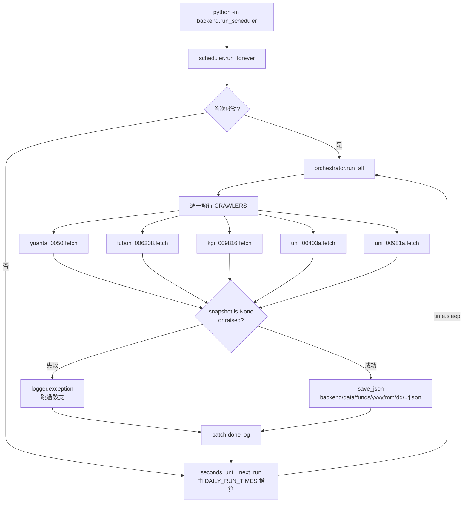
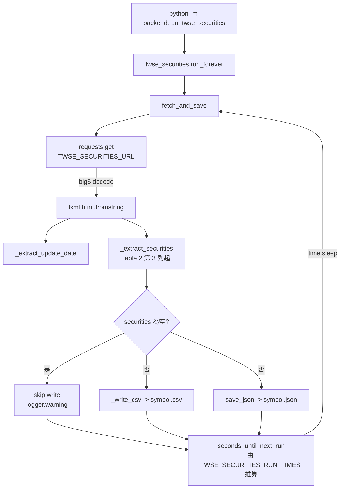
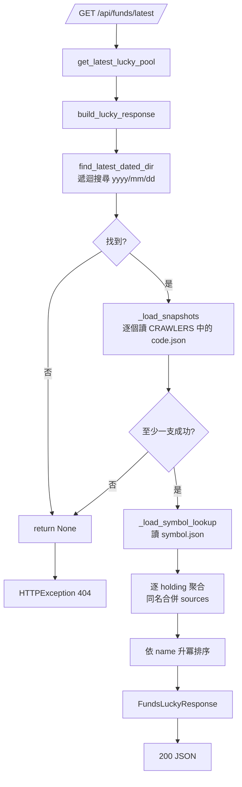

# 基金資料管線流程圖

> 對應實作：[funds_pipeline.md](../guides/funds_pipeline.md)、[twse_securities.md](../guides/twse_securities.md)、[lucky_draw.md](../guides/lucky_draw.md)。

---

## 1. ETF 成分股爬蟲與儲存

**重點**：

- 同一天多次執行寫進同一個 `yyyy/mm/dd` 資料夾，後者覆寫前者。
- 任何單支 crawler 拋例外都被 `orchestrator._run_single()` 接住，不影響其餘 crawler。

---

## 2. TWSE 證券清單爬蟲與儲存

**重點**：

- 解析失敗時不覆寫，保留前一份有效資料。
- `symbol.json` 是抽抽樂查代號 / 產業別的唯一來源。

---

## 3. 抽抽樂聚合（讀取端）

---

## 名詞對照表

| 流程圖節點 | 程式碼位置 |
|------------|-----------|
| `scheduler.run_forever` | [core/funds/scheduler.py](../../core/funds/scheduler.py) `run_forever()` |
| `orchestrator.run_all` | [core/funds/orchestrator.py](../../core/funds/orchestrator.py) `run_all()` |
| `seconds_until_next_run` | [core/funds/_schedule_utils.py](../../core/funds/_schedule_utils.py) |
| `save_json` | [core/shared/json_storage.py](../../core/shared/json_storage.py) |
| `fetch_and_save` | [core/funds/twse_securities.py](../../core/funds/twse_securities.py) |
| `build_lucky_response` | [core/funds/lucky_aggregator.py](../../core/funds/lucky_aggregator.py) |
| `find_latest_dated_dir` | 同上 |
| `_load_snapshots` / `_load_symbol_lookup` | 同上 |
| `get_latest_lucky_pool` | [routers/funds.py](../../routers/funds.py) |
