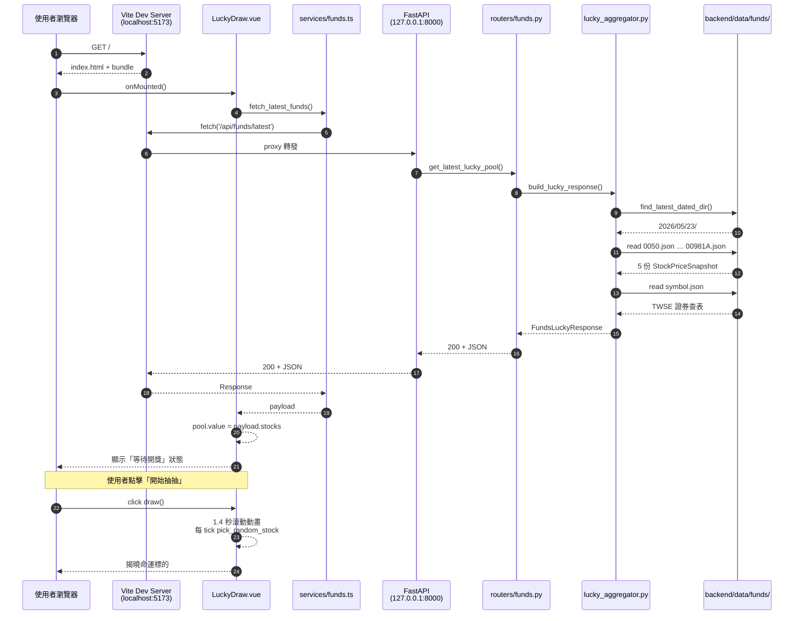
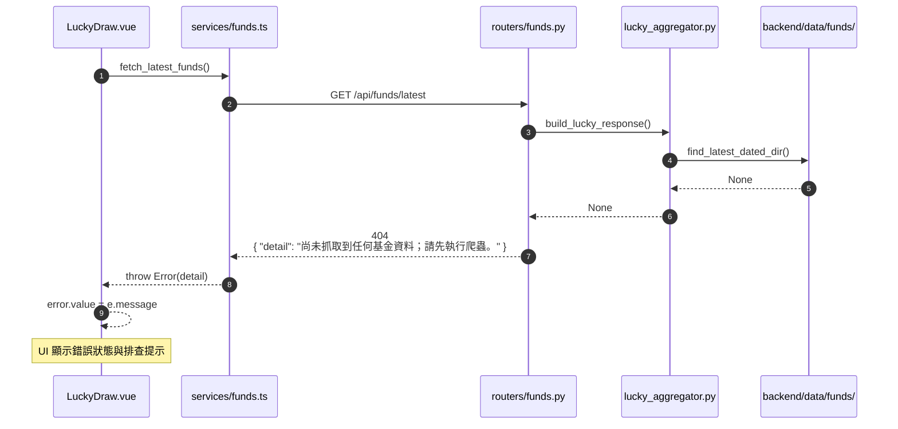

# 抽抽樂 API 互動循序圖

> 對應實作：[lucky_draw.md](../guides/lucky_draw.md)、[api_docs.md `GET /api/funds/latest`](../api_docs.md#get-apifundslatest)。
> 前端動畫流程見 [frontend_integration.md](../../../frontend/docs/guides/frontend_integration.md)。

---

## 正常流程（200）

---

## 無資料時（404）

---

## 重點說明

| 步驟 | 對應程式碼 |
|------|-----------|
| `proxy 轉發` | [frontend/vite.config.ts](../../../frontend/vite.config.ts) `server.proxy['/api']` → `http://127.0.0.1:8000` |
| `pick_random_stock` | [frontend/src/services/funds.ts](../../../frontend/src/services/funds.ts) |
| 1.4 秒滾動動畫 | [frontend/src/views/LuckyDraw.vue](../../../frontend/src/views/LuckyDraw.vue) `draw()` |
| 路由 404 訊息 | [backend/routers/funds.py](../../routers/funds.py) `HTTPException(status_code=404, detail=...)` |
