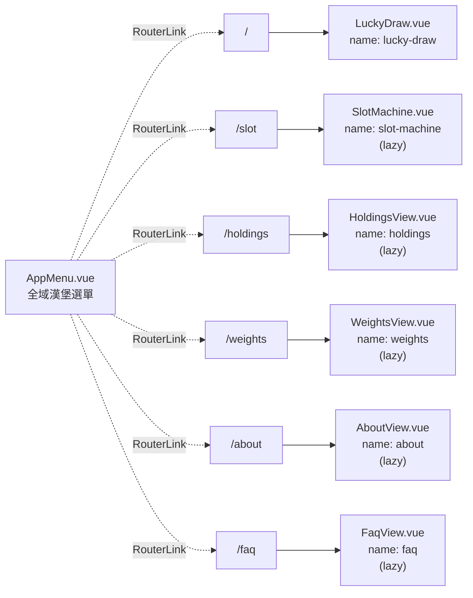
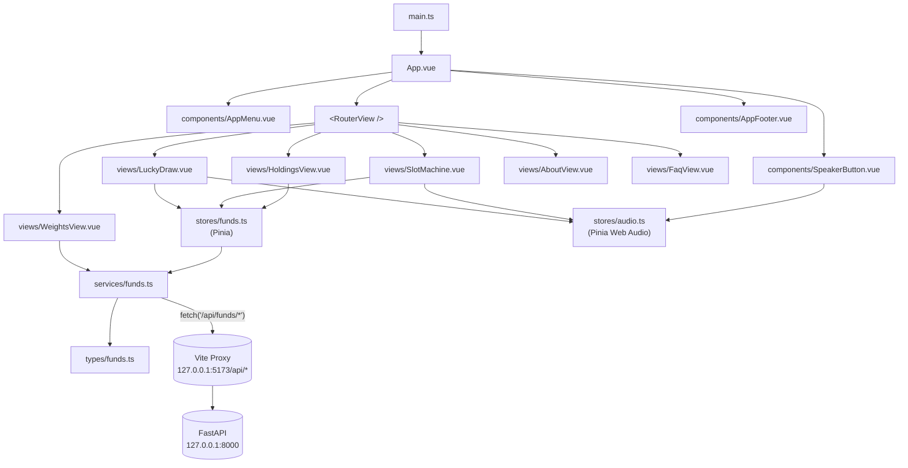

# 前端頁面結構

> **現行完整路由、安裝與建置說明請以專案根目錄 [`README.md`](../../../README.md) 為準。**
> 與 [frontend_integration.md](../guides/frontend_integration.md) 配合閱讀。

---

## 路由樹（共 6 條路由）

導覽由左上角 [AppMenu](../../src/components/AppMenu.vue) 與頁尾 [AppFooter](../../src/components/AppFooter.vue) 提供；漢堡按鈕展開後包含六大頁面 `<RouterLink>`（命定抽抽樂 → 命定拉霸機 → 五檔 ETF 成分股一覽 → 各 ETF 權重查詢 → 關於本站 → 常見問題），路由變更時面板自動收合。

---

## 元件相依

`LuckyDraw`、`SlotMachine` 與 `HoldingsView` 共用 `use_funds_store()`，僅首次 `ensure_loaded()` 真正發送 `/api/funds/latest` 請求；`WeightsView` 則呼叫 `fetch_funds_by_etf()` 讀取 `/api/funds/by_etf`。

---

## 全域樣式 / 主題

| 位置 | 內容 |
|------|------|
| [App.vue](../../src/App.vue) `<style>` | 全域 reset（`* box-sizing`）、字型 stack、`color-scheme: dark`、`body` 背景色 |
| [LuckyDraw.vue](../../src/views/LuckyDraw.vue) `<style scoped>` | 抽抽樂頁專屬樣式；含 aurora 背景、卡片 glassmorphism、滾動動畫、PONG 衝擊 keyframes |
| [SlotMachine.vue](../../src/views/SlotMachine.vue) `<style scoped>` | 拉霸機頁專屬樣式；金 / 粉 vegas 跑馬燈、三軸 reel-strip 滾動、JACKPOT 飛字、彩帶與金幣雨 keyframes |
| [HoldingsView.vue](../../src/views/HoldingsView.vue) `<style scoped>` | 持股表頁面樣式；同主題的 aurora 背景 + 玻璃卡片 + sticky table head |
| [WeightsView.vue](../../src/views/WeightsView.vue) `<style scoped>` | 各 ETF 權重明細與官方來源連結展示樣式 |
| [AboutView.vue](../../src/views/AboutView.vue) / [FaqView.vue](../../src/views/FaqView.vue) `<style scoped>` | 關於本站與常見問題長文閱讀版型 |
| [AppMenu.vue](../../src/components/AppMenu.vue) `<style scoped>` | 左上漢堡按鈕 + 小型下拉導覽面板 |

> 目前未抽出 design tokens；色票（藍紫 `#b3b8ff` / `#7ec8ff`）與圓角 / 陰影規格散落於各元件。若未來再多兩三頁，再考慮抽 `assets/main.css` 或 CSS custom properties。

---

## 元件職責摘要

| 元件 / 模組 | 職責 |
|-------------|------|
| [main.ts](../../src/main.ts) | `createApp`、安裝 Pinia 與 Router、`#app` mount |
| [App.vue](../../src/App.vue) | 全域 layout：`<AppMenu />` + `<SpeakerButton />` + `<RouterView />` + `<AppFooter />` |
| [router/index.ts](../../src/router/index.ts) | 路由表：`/`（LuckyDraw 立即載入）/ `/slot`、`/holdings`、`/weights`、`/about`、`/faq`（懶載入）與 SEO Head 更新 |
| [components/AppMenu.vue](../../src/components/AppMenu.vue) | 左上漢堡按鈕 + 六路由下拉導覽面板；ESC / 背景點擊 / 路由變更皆會收合 |
| [components/SpeakerButton.vue](../../src/components/SpeakerButton.vue) | 右上角音效靜音切換按鈕 |
| [components/AppFooter.vue](../../src/components/AppFooter.vue) | 全域頁尾導覽連結與非投資建議免責聲明對話框 |
| [views/LuckyDraw.vue](../../src/views/LuckyDraw.vue) | 抽抽樂主頁：滾動動畫 / PONG 衝擊 / 結果展示 |
| [views/SlotMachine.vue](../../src/views/SlotMachine.vue) | 命定拉霸機：三軸 reel-strip 同框、保底連線、JACKPOT 飛字 + 彩帶 + 金幣雨 |
| [views/HoldingsView.vue](../../src/views/HoldingsView.vue) | 五檔 ETF 持股對照表頁：搜尋 / 產業 / ETF 篩選、依「選股陣容」筆數排序 |
| [views/WeightsView.vue](../../src/views/WeightsView.vue) | 各 ETF 權重查詢頁：依單一 ETF 檢視完整持股權重、更新日期與官方來源連結 |
| [views/AboutView.vue](../../src/views/AboutView.vue) | 關於本站頁：隨機漫步、效率市場假說、SPIVA 與遊戲化設計背景說明 |
| [views/FaqView.vue](../../src/views/FaqView.vue) | 常見問題頁：選樣原因、資料更新機制、隱私聲明與問題回饋說明 |
| [stores/funds.ts](../../src/stores/funds.ts) | Pinia store；`ensure_loaded()` / `refresh()` + 共享資料 |
| [stores/audio.ts](../../src/stores/audio.ts) | Pinia store；Web Audio API 即時音效合成（`play_tick`、`play_ding`）與靜音管理 |
| [services/funds.ts](../../src/services/funds.ts) | API 客戶端：`fetch_latest_funds()`、`fetch_funds_by_etf()`、`pick_random_stock()` |
| [types/funds.ts](../../src/types/funds.ts) | 與後端 schema 對齊的 TS 介面 |

---

## 未來擴充建議

| 情境 | 觸動的模組 / 文件 |
|------|------------------|
| 新增「歷史抽取紀錄」頁 | `views/`、`router/index.ts`、`components/AppMenu.vue` 新增一個 `NAV_ITEM`、本 sitemap |
| 新增「ETF 詳細列表」頁 | `views/`、新後端端點、`api_docs.md`、`frontend_integration.md` |
| store 寫入後刷新 | `stores/funds.ts` `refresh()`、可在 AppMenu 加重新整理按鈕 |
| 引入 i18n | `main.ts`、`App.vue`、各 `views/`、`AppMenu.vue` NAV_ITEMS |
| Production 部署 | `vite.config.ts` proxy 改由 Nginx 取代、CORS 設定、`api_docs.md` 部署段 |
